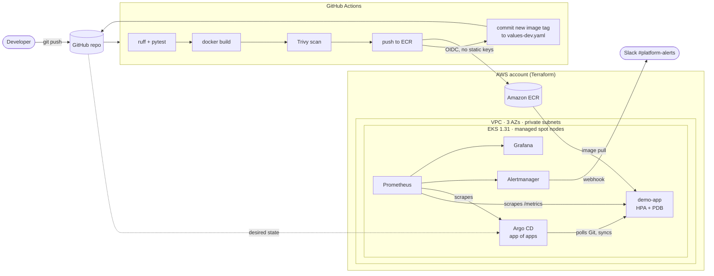

# EKS GitOps Platform

A small but complete internal platform on AWS: Terraform builds the cluster, GitHub Actions builds and scans the app, Argo CD deploys whatever is in Git, and Prometheus/Grafana watch it with SLO-based alerts that land in Slack.

[](https://github.com/JSR-codes/eks-gitops-platform/actions/workflows/app-ci.yml)
[](https://github.com/JSR-codes/eks-gitops-platform/actions/workflows/terraform-ci.yml)
[](https://github.com/JSR-codes/eks-gitops-platform/actions/workflows/manifests-ci.yml)

## Architecture



**Flow of a change:** push to `app/` → tests, image build and vulnerability scan → image pushed to ECR with the short commit SHA as its tag → CI commits that tag to `charts/demo-app/values-dev.yaml` → Argo CD sees the commit and rolls it out. CI never holds cluster credentials; the cluster pulls its own state from Git.

**Rollback** is `git revert` of the tag-bump commit. Argo CD syncs the previous tag back within its 60-second poll.

## What's in here

| Path | What it does |
|---|---|
| `terraform/bootstrap` | S3 bucket (versioned, public access blocked) and DynamoDB lock table, both encrypted with a customer-managed KMS key with rotation |
| `terraform/envs/dev` | VPC across 3 pinned AZs, EKS cluster with managed node group, EBS CSI driver via IRSA, ECR repo, GitHub OIDC role, Argo CD install |
| `terraform/modules/github-oidc` | Reusable module that lets GitHub Actions assume an AWS role with short-lived tokens |
| `app/` | Python service exposing request, latency and build-info metrics |
| `charts/demo-app` | Helm chart: zero-downtime rolling updates, HPA, PodDisruptionBudget, zone spread, non-root and read-only filesystem |
| `gitops/apps` | Argo CD Applications, ordered with sync waves (monitoring CRDs before apps that use them) |
| `gitops/monitoring` | SLO recording rules, burn-rate alerts, Argo CD alerts, Grafana dashboard as code |
| `gitops/values` | kube-prometheus-stack values with Slack routing |
| `.github/workflows` | App pipeline, Terraform checks (fmt, validate, tflint, Checkov, PR plan), manifest validation (helm lint, kubeconform) |
| `scripts/` | Secret creation, an end-to-end alert test, and a script that measures delivery metrics |

## Design decisions

- **Pull-based deploys.** CI only writes to Git. Argo CD is the only thing with write access to the cluster, so the cluster can't drift from what's reviewed in Git, and `selfHeal` reverts manual `kubectl` edits.
- **No long-lived AWS keys.** GitHub Actions authenticates through OIDC, scoped to this repo and to pushing a single ECR repository.
- **Immutable image tags.** ECR rejects overwriting a tag, so the tag in Git always maps to exactly one image.
- **Alerts on SLO burn rate, not raw thresholds.** A 99.5% availability target with multi-window burn-rate alerts (fast: 14.4× over 1h and 5m, slow: 6× over 6h and 30m) pages on real user impact and stays quiet on brief blips.
- **Secrets stay out of Git.** The Slack webhook and Grafana password are created once with `scripts/create-secrets.sh` and mounted by reference.
- **Cost-conscious dev.** Spot nodes and a single NAT gateway. Notes in the code mark what to change for production.

## Run it yourself

**Prerequisites:** an AWS account, AWS CLI, Terraform ≥ 1.6, kubectl, a Slack incoming webhook.

> Running this creates billable resources (EKS control plane, NAT gateway, EC2 nodes). Expect roughly $5–7 per day; tear it down when you're done.

```bash
# 1. Remote state (once)
cd terraform/bootstrap
terraform init && terraform apply
terraform output   # note state_bucket and lock_table

# 2. Cluster + Argo CD
cd ../envs/dev
cp backend.hcl.example backend.hcl            # fill in values from step 1
cp terraform.tfvars.example terraform.tfvars  # add your IAM ARN
terraform init -backend-config=backend.hcl
terraform apply
$(terraform output -raw kubeconfig_command)

# 3. Secrets for Slack and Grafana
cd ../../..
SLACK_WEBHOOK_URL=https://hooks.slack.com/services/... bash scripts/create-secrets.sh

# 4. Point GitHub Actions at AWS
#    Repo → Settings → Secrets and variables → Actions
#    Secret   AWS_ROLE_ARN = $(terraform -chdir=terraform/envs/dev output -raw github_ci_role_arn)
#    Variable AWS_REGION   = us-east-1

# 5. Ship the first build
#    Actions → app-ci → Run workflow (later, any push under app/ triggers it)
```

Until that first build finishes, `demo-app` shows `ImagePullBackOff` because the placeholder `bootstrap` tag doesn't exist in ECR. That's expected.

Then:

```bash
kubectl -n argocd port-forward svc/argocd-server 8080:80        # Argo CD UI
kubectl -n argocd get secret argocd-initial-admin-secret -o jsonpath='{.data.password}' | base64 -d
kubectl -n monitoring port-forward svc/kube-prometheus-stack-grafana 3000:80   # Grafana → Platform folder
```

Prove the alert path works end to end with `bash scripts/test-alert.sh`, which injects a 30% error rate through Git and waits for the page in Slack.

**Tear down:** `terraform destroy` in `terraform/envs/dev`. The state bucket has `prevent_destroy` on purpose.

## Results

Measured on my own deployment with `bash scripts/measure-delivery.sh`. Fill these in after running it.

| Metric | How it's measured | Result |
|---|---|---|
| Commit → running in cluster | Commit time to Argo CD `Healthy` | _TBD_ |
| Rollback time | `git revert` pushed → previous version `Healthy` | _TBD_ |
| CI pipeline duration | app-ci run time on `main` | _TBD_ |
| Deploy frequency | Tag-bump commits per week | _TBD_ |
| Alert latency | Error injection → Slack message | _TBD_ |
| Daily cost | AWS Cost Explorer, tag `Project=eks-gitops-platform` | _TBD_ |

Screenshots: _add Argo CD app tree, Grafana dashboard and a Slack alert to `docs/images/`._

## Runbook

Every alert links to its section in [docs/runbook.md](docs/runbook.md).

## License

MIT
